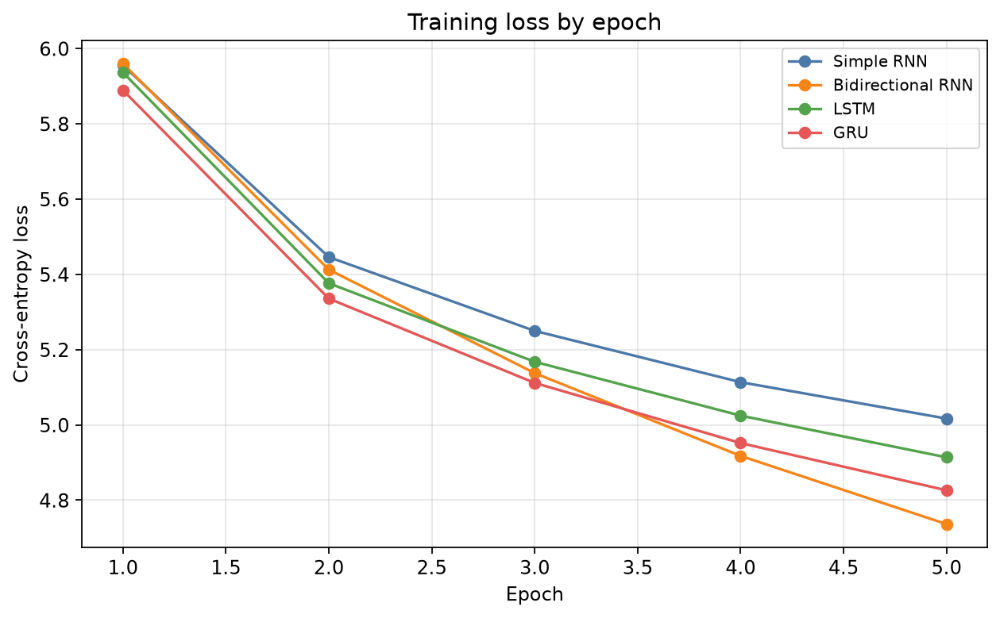
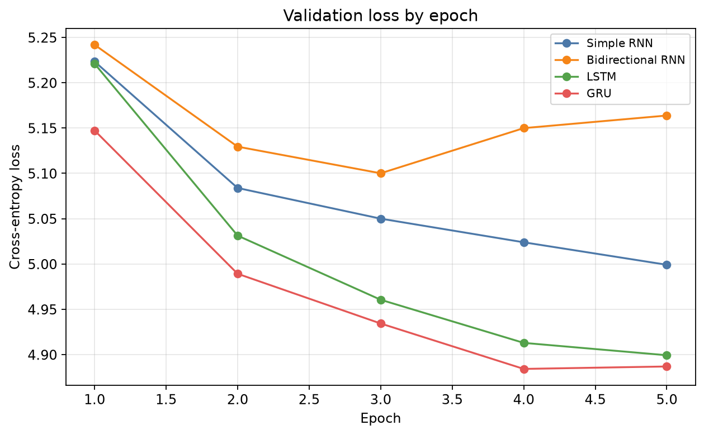
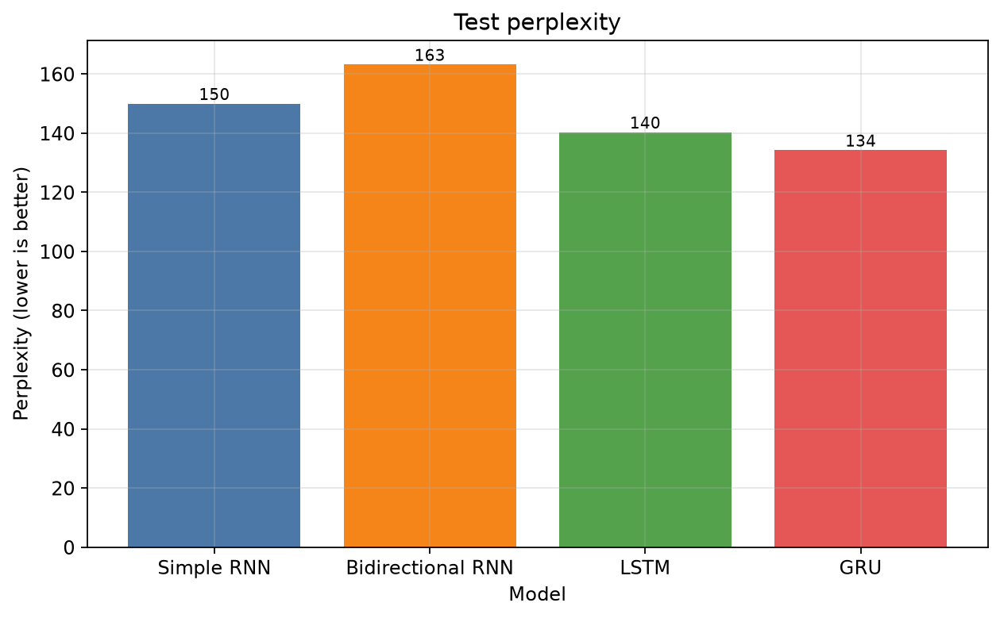
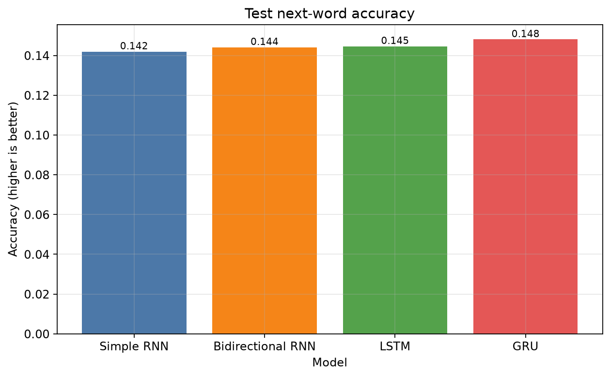
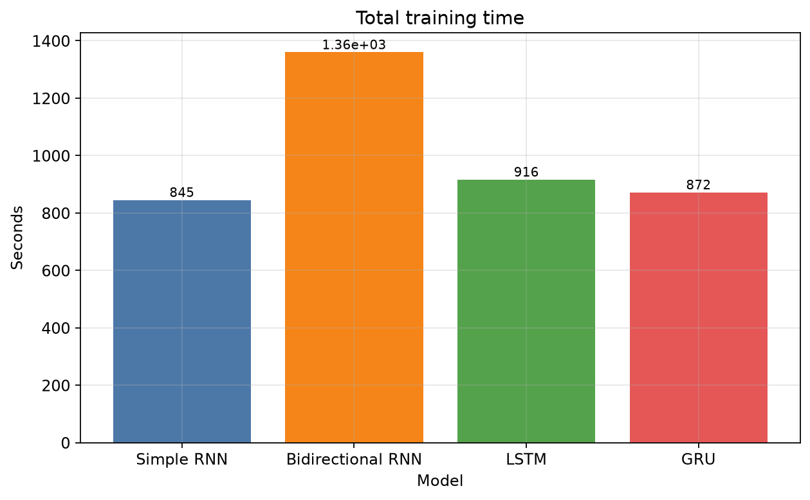
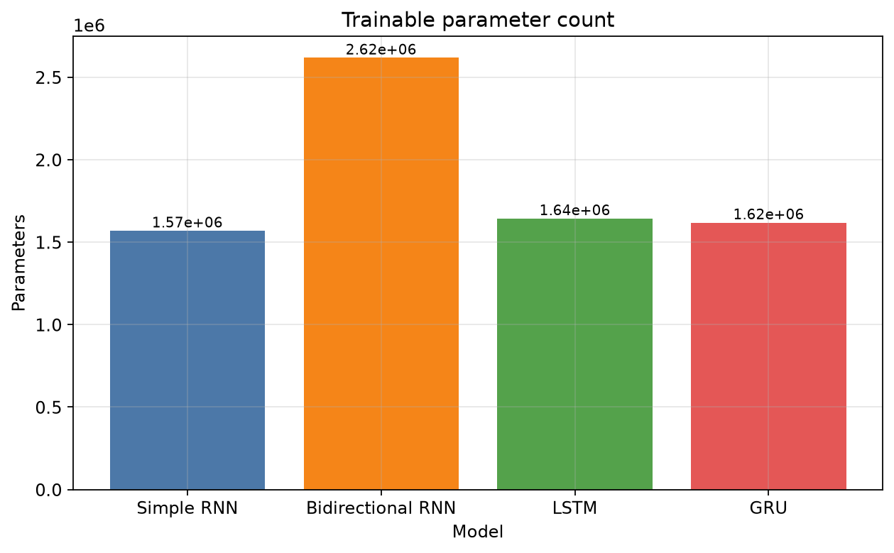
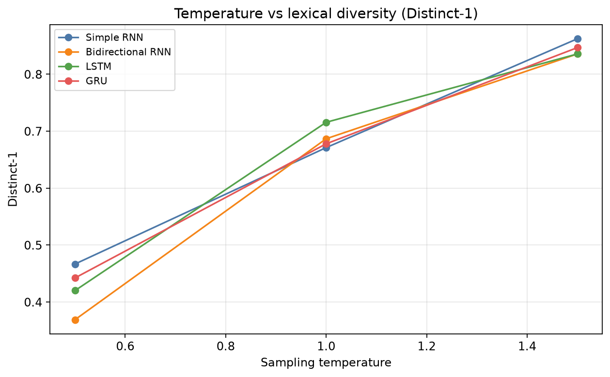
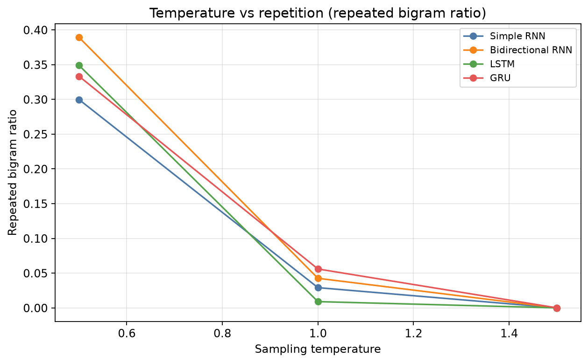

# Tiny Shakespeare Word-Level Autoregressive Text Generation

**Course:** ICT4403 Foundations of Generative AI  
**Assignment:** Assignment 2  
**Task:** Word-level next-token prediction and autoregressive generation with Simple RNN, Bidirectional RNN, LSTM, and GRU.

## Overview

This repository trains four recurrent neural networks on [Tiny Shakespeare](https://raw.githubusercontent.com/karpathy/char-rnn/master/data/tinyshakespeare/input.txt) to predict the next word after a 20-token context window. The same splits, vocabulary, sequence length, optimizer, and epoch budget are used for every architecture so quantitative differences are comparable.

## Objectives

- Preprocess Tiny Shakespeare with word-level tokenization.
- Build input–target windows for next-word prediction.
- Train Simple RNN, Bidirectional RNN, LSTM, and GRU under matched settings.
- Compare loss, perplexity, next-word accuracy, training time, and parameter count.
- Generate text from identical seeds at temperatures 0.5, 1.0, and 1.5.
- Analyse temperature, diversity, repetition, and bidirectional-model limitations.

## Dataset

- **Name:** Tiny Shakespeare
- **Direct source URL:** https://raw.githubusercontent.com/karpathy/char-rnn/master/data/tinyshakespeare/input.txt
- **Original file size:** 1115394 bytes
- **Decoded characters:** 1115394
- **Word-level tokens:** 253599
- **Unique types in the full corpus:** 14297
- **Train / validation / test tokens:** 202879 / 25359 / 25361
- **Train-only vocabulary size (including specials):** 8000

Tiny Shakespeare is a public-domain concatenation of Shakespeare plays, widely used in language-modelling tutorials. This project uses **word-level** tokens rather than characters, which matches the assignment's next-word prediction requirement.

The original file is small (~1.1 MB) and is included under `data/raw/input.txt` after download so the experiment is reproducible offline. `download_data.py` still fetches and validates the canonical URL when the file is missing.

## Download procedure

```powershell
python download_data.py
```

The script skips the network request when a non-empty, decodable `data/raw/input.txt` already exists. Use `--force` to download again.

## Word-level next-token prediction

Given tokens `To be or not to be` and a window of five input tokens:

- **Input:** `To be or not to`
- **Target:** `be`

The trained models output a distribution over the vocabulary for that next token. Autoregressive generation samples a token, appends it, and repeats.

## Preprocessing methodology

1. Decode UTF-8 text and normalize line endings.
2. Remove unwanted ASCII control characters.
3. Convert newlines to spaces; collapse repeated whitespace.
4. Keep case, punctuation, speaker names, and contractions.
5. Tokenize with a regex that keeps internal apostrophes and isolates punctuation.

Details: `docs/methodology.md`.

## Vocabulary construction

Special tokens `<PAD>`, `<UNK>`, `<BOS>`, and `<EOS>` occupy the first indices. Remaining slots, up to 8000 total, are the most frequent **training** types. Validation and test tokens never influence the vocabulary. Unseen types map to `<UNK>`.

Actual vocabulary size used by the models: **8000**.

## Input–target sequence construction

`NextTokenDataset` yields windows of length L = 20 with stride 1. Target is the token immediately after the window. Splits are applied on the linear token stream **before** windowing so no sequence crosses a boundary.

Chronological 80/10/10 splitting is used because the source is a continuous literary text. Later acts/passages form a held-out continuation rather than randomly mixed lines.

## Architectures

All four models share embedding dimension 64, hidden dimension 128, dropout 0.2, and a linear classifier over the vocabulary.

| Model | PyTorch module | Next-token representation |
| --- | --- | --- |
| Simple RNN | `nn.RNN` | Last observed hidden state |
| Bidirectional RNN | `nn.RNN(bidirectional=True)` | Concatenation of final forward and backward states |
| LSTM | `nn.LSTM` | Last-layer hidden state |
| GRU | `nn.GRU` | Last-layer hidden state |

The Bidirectional RNN may read the already observed window from both ends. It never sees the target token. During generation it re-encodes the current window; it is **not** a strictly causal language model.

## Training methodology

- Optimizer: Adam
- Learning rate: 0.001
- Batch size: 64
- Epochs: 5
- Loss: token-level cross-entropy (padding ignored)
- Gradient clipping: 1.0
- Random seed: 42
- Device actually used: `cpu`

The checkpoint with the lowest **validation** loss is saved for each architecture. The test set is not used for selection, early stopping, or hyperparameter search.

## Evaluation metrics and formulas

- **Cross-entropy:** mean token-level negative log-likelihood of the true next token.
- **Perplexity:** `exp(mean cross-entropy)`. Lower is better under a matched evaluation setup. It estimates how many tokens the model is choosing among, on average.
- **Next-word accuracy:** fraction of targets equal to `argmax` of the predicted distribution.
- **Training time:** `time.perf_counter()` wall-clock over the training loop.
- **Parameter count:** number of trainable tensors.

Generation-side metrics (not coherence proofs):

- Unique-token ratio = `|set(tokens)| / |tokens|`
- Distinct-1 = unique unigrams / unigram count
- Distinct-2 = unique bigrams / bigram count
- Repeated bigram ratio = bigram instances with count > 1, divided by bigram count

## Actual quantitative results

Validation:

| display_name | val_loss | val_perplexity | val_accuracy | parameter_count | total_training_time_sec |
| --- | --- | --- | --- | --- | --- |
| Simple RNN | 4.9991 | 148.2804 | 0.1495 | 1568832 | 845.2732 |
| Bidirectional RNN | 5.1001 | 164.0356 | 0.1455 | 2617664 | 1359.7653 |
| LSTM | 4.8993 | 134.1932 | 0.1551 | 1643328 | 916.2384 |
| GRU | 4.8842 | 132.1839 | 0.1602 | 1618496 | 871.6444 |

Test:

| display_name | test_loss | test_perplexity | test_accuracy | parameter_count | total_training_time_sec |
| --- | --- | --- | --- | --- | --- |
| Simple RNN | 5.0100 | 149.9073 | 0.1419 | 1568832 | 845.2732 |
| Bidirectional RNN | 5.0946 | 163.1450 | 0.1441 | 2617664 | 1359.7653 |
| LSTM | 4.9435 | 140.2616 | 0.1446 | 1643328 | 916.2384 |
| GRU | 4.8992 | 134.1788 | 0.1480 | 1618496 | 871.6444 |

Machine-readable copies: `results/metrics/test_metrics.csv`, `results/metrics/validation_metrics.csv`, `results/metrics/model_summary.json`.

## Training and validation plots





## Test performance comparison









## Generated-text samples

Seeds: `ROMEO:`, `KING:`, `To be, or not to be`.  
Temperatures: 0.5, 1.0, 1.5.  
Complete dump: [results/generated_text/generated_samples.md](results/generated_text/generated_samples.md).

Representative `ROMEO:` continuations at temperature 1.0:

### Simple RNN

```text
ROMEO: O, Hermione burn one here? any day, which I have seen with dead belly. ROMEO: O blessed she is for Lord and, I hope ' weary march against this methought and our behalf me. 3 KING RICHARD III: My gracious good part been? DERBY; So, farewell, she are steel for your Resolved. QUEEN ELIZABETH: Come of sovereign, after it i ' the noble prince. Nurse: My gracious lord, cousin, like a long? YORK: When hasty are gentle period and yourself I blest To run seeing be so, I know not lost to Edward. SI
```
### Bidirectional RNN

```text
ROMEO: O, Hermione buy one of fair of day, which I have may not dead belly. KING HENRY VI: Well, for Lord Hastings, you once ' weary march against this dishes contract and our behalf voice. BUCKINGHAM: Why not good from me, I have given and such, Lest thy sword; A two love of Resolved way. DORSET: Come of him houses, I'll say the sink of such end hither. My ambitious Coriolanus! All: You shall not feel away, When hasty be befall conduct. JULIET: Peace, I do be, I'll tell my sighs lost to Edward.
```
### LSTM

```text
ROMEO: O, Hermione burn one of fair any suit: This seems may not understand belly. ROMEO: O blessed voices! for Lord seems, you once the weary march against this dishes, and myself, ay. 3 KING HENRY VI CAPULET: Her good part been? DERBY: Ay, farewell: she is steel love and Resolved. BRUTUS: Well, but sovereign to the very i ' the noble eagle I hither In Greece by mine eyes: if it long to very; hasty, gentle conduct. JULIET: As certain I do return, I'll tell my sighs; And Edward England's face th
```
### GRU

```text
ROMEO: visor, surety presently one inherited fair any day: This seems may not dead belly. ROMEO: O blessed bed! ah: I rise you once ' weary march, from whom I hope! MAMILLIUS: I will can't not not good from me, I been prepared and such, I shall shun ye. First Keeper: Resolved way. DORSET: Nay, sovereign cannot tempest them i ' LADY ANNE. GLOUCESTER: In so ambitious no certain prison: it is long is very; hasty are it so rich yourself I chosen To run it be so, I know not lost to me. I will be drin
```


## Temperature analysis





Full write-up: [results/reports/temperature_analysis.md](results/reports/temperature_analysis.md).

Temperature divides logits before softmax. Lower T concentrates mass on high-probability tokens; higher T flattens the distribution. Whether that produces more repetition or more incoherence is an empirical question for each checkpoint and is discussed from the saved samples.

## Diversity and repetition analysis

| model | temperature | unique_token_ratio | distinct_1 | distinct_2 | repeated_bigram_ratio | average_length |
| --- | --- | --- | --- | --- | --- | --- |
| bidirectional_rnn | 0.5000 | 0.3689 | 0.3689 | 0.7248 | 0.3893 | 150.0000 |
| bidirectional_rnn | 1.0000 | 0.6867 | 0.6867 | 0.9776 | 0.0425 | 150.0000 |
| bidirectional_rnn | 1.5000 | 0.8356 | 0.8356 | 1.0000 | 0.0000 | 150.0000 |
| gru | 0.5000 | 0.4422 | 0.4422 | 0.7808 | 0.3333 | 150.0000 |
| gru | 1.0000 | 0.6778 | 0.6778 | 0.9709 | 0.0559 | 150.0000 |
| gru | 1.5000 | 0.8467 | 0.8467 | 1.0000 | 0.0000 | 150.0000 |
| lstm | 0.5000 | 0.4200 | 0.4200 | 0.7718 | 0.3490 | 150.0000 |
| lstm | 1.0000 | 0.7156 | 0.7156 | 0.9955 | 0.0089 | 150.0000 |
| lstm | 1.5000 | 0.8356 | 0.8356 | 1.0000 | 0.0000 | 150.0000 |
| simple_rnn | 0.5000 | 0.4667 | 0.4667 | 0.8076 | 0.2998 | 150.0000 |
| simple_rnn | 1.0000 | 0.6711 | 0.6711 | 0.9843 | 0.0291 | 150.0000 |
| simple_rnn | 1.5000 | 0.8622 | 0.8622 | 1.0000 | 0.0000 | 150.0000 |

High distinct-n is not the same as fluent Shakespeare. These numbers complement, rather than replace, reading the samples.

## Bidirectional RNN limitations

A bidirectional encoder looks at the full *observed* window, including tokens to the right of earlier positions. That can help next-token classification when the entire window is already known, but it does not match the causal process of writing one word at a time from left to right. Rolling the model out still requires re-encoding a window of past tokens and cannot be interpreted as a hidden state that never saw future context *inside that window*. For a production causal LM, unidirectional LSTM/GRU (or a causal Transformer) is the appropriate inductive bias.

## Best-performing model and evidence

**GRU** is selected using: Primary: lowest test perplexity (equivalently lowest test cross-entropy) on the held-out chronological test split. Secondary: test next-word accuracy and generated-text diversity/repetition. Training loss was not used for selection.

- Test perplexity: 134.1788
- Test loss: 4.8992
- Test accuracy: 0.1480

See [results/reports/experimental_analysis.md](results/reports/experimental_analysis.md) for the architecture discussion.

## Installation

Python 3.10 or 3.11 is the intended target. This run used the local interpreter documented in `docs/EXECUTION_STATUS.md`.

### Windows PowerShell

```powershell
python -m venv .venv
.\.venv\Scripts\Activate.ps1
python -m pip install --upgrade pip
pip install torch --index-url https://download.pytorch.org/whl/cpu
pip install -r requirements.txt
python download_data.py
python main.py --mode all
```

If PowerShell blocks scripts, run `Set-ExecutionPolicy -Scope CurrentUser RemoteSigned` or invoke `.\.venv\Scripts\python.exe` without activating.

### Linux / macOS

```bash
python3 -m venv .venv
source .venv/bin/activate
python -m pip install --upgrade pip
pip install torch --index-url https://download.pytorch.org/whl/cpu
pip install -r requirements.txt
python download_data.py
python main.py --mode all
```

GPU is optional. The code uses CUDA when `torch.cuda.is_available()` is true; otherwise it runs on CPU.

## Exact pipeline commands

```powershell
python download_data.py
python main.py --mode preprocess
python main.py --mode train
python main.py --mode evaluate
python main.py --mode generate
python main.py --mode all
```

Useful flags:

```powershell
python main.py --mode train --force-retrain
python main.py --mode all --epochs 5 --batch-size 64
python -m pytest -q
python create_submission.py
```

## Repository structure

```text
.
├── README.md
├── requirements.txt
├── config.yaml
├── main.py
├── download_data.py
├── train.py
├── evaluate.py
├── generate.py
├── create_submission.py
├── src/
├── tests/
├── notebooks/assignment_analysis.ipynb
├── data/raw/input.txt
├── data/processed/
├── checkpoints/          # best *.pt files, recreated by training
├── results/
│   ├── metrics/
│   ├── generated_text/
│   ├── figures/
│   └── reports/
├── docs/
└── submission/
```

## Dependencies

See `requirements.txt`. Core packages: PyTorch, NumPy, pandas, matplotlib, PyYAML, pytest, Jupyter tooling, python-docx. No paid APIs or hosted models are required.

## Reproducibility

- Config lives in `config.yaml` (seed 42).
- Vocabulary and encoded split ids are stored under `data/processed/`.
- Best checkpoints store architecture, hyperparameters, epoch, and validation loss.
- Generation uses stored sampling seeds.
- Retrain with `--force-retrain` if the vocabulary or sequence length changes; incompatible checkpoints are rejected.

Checkpoints are gitignored because they are large binary files. Recreate them with `python main.py --mode train`.

## Limitations

- Small corpus and a hard 8,000-token vocabulary leave many rare words as `<UNK>`.
- Context is only 20 tokens.
- Recurrent hidden states compress history lossily.
- Five epochs is a matched budget, not an exhaustive search.
- Generated verse often repeats or drifts.
- Bidirectional encoding of the window is not causal generation.

## Conclusion

Four recurrent models were trained and evaluated under matched word-level next-token conditions on Tiny Shakespeare. On the held-out chronological test split, **GRU** is the strongest quantitative system (test perplexity 134.1788). Qualitative judgement of Shakespearean style still depends on temperature and remains imperfect for all four architectures.

## License / data note

Tiny Shakespeare is derived from public-domain Shakespeare texts as distributed by the [char-rnn](https://github.com/karpathy/char-rnn) project. Include attribution to that source when redistributing the raw file.
